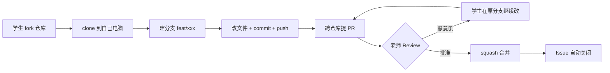

# PR 实操示范：一次完整的「提交 → 评审 → 合并」

> 这不是编出来的教程，而是真实发生在 `pr-workshop` 仓库里的一条 PR。
> 学生和老师都可以对照着看、照着做——**先看完整个故事，再自己上手。**

---

## 0. 先看这条真实 PR

**[👉 打开演示 PR #3](https://github.com/jiangwang-coding/pr-workshop/pull/3)**

| 项目 | 内容 |
|------|------|
| 提交者 | `trizoic`（学生，模拟） |
| 任务来源 | [Issue #1](https://github.com/jiangwang-coding/pr-workshop/issues/1)：把自己加进班级成员名单 |
| 改动内容 | `tasks/MEMBERS.md`，+2 行 −1 行 |
| 分支方向 | `trizoic:feat/trizoic-issue1` → `jiangwang-coding:main` |
| 评审记录 | 1 条修改意见 + 1 条批准 |
| 最终结果 | ✅ squash 合并（`4370fe9`），Issue #1 自动关闭 |

一句话概括：**学生 fork 仓库 → 建分支改文件 → 跨仓库提 PR → 老师 review 提意见 → 批准 → 合并 → Issue 自动关闭。**

---

## 1. 全流程地图



注意那个**回路**：收到修改意见后，学生在**同一个分支**继续改，push 后 PR 会自动更新，不需要重新提。这是 PR 和普通发文件最不一样的地方。

---

## 2. 学生视角：一步步怎么做

### 第 1 步：fork 仓库

打开原仓库 https://github.com/jiangwang-coding/pr-workshop，点右上角 **Fork**，选自己的账号。

> **为什么 fork？** 因为学生对原仓库没有写权限。fork 会在自己账号下复制一份，你对它有完全控制权。改完再"请求"原仓库接收——这就是 Pull Request 名字的由来。

### 第 2 步：clone 到本地

```bash
git clone https://github.com/你的用户名/pr-workshop.git
cd pr-workshop
git remote add upstream https://github.com/jiangwang-coding/pr-workshop.git
```

`upstream` 指向原仓库，以后同步老师的更新要用。

### 第 3 步：建分支（关键！不要直接在 main 上改）

```bash
git checkout -b feat/你的名字-issue编号
# 本次演示用的是: git checkout -b feat/trizoic-issue1
```

**分支是 PR 的基石**：你改的东西都在分支上，主干 `main` 保持干净。PR 比较的就是「你的分支」和「主干」之间的差异。

### 第 4 步：改文件 + 提交

本次演示改的是 `tasks/MEMBERS.md`，加了一行：

```diff
 | 序号 | 姓名 | GitHub 账号 |
 |------|------|-------------|
 | 1 | 老师 | jiangwang-coding |
+| 2 | 张三（演示学生） | trizoic |
```

提交：

```bash
git add tasks/MEMBERS.md
git commit -m "feat: 把自己加入成员名单(练习1)"
git push -u origin feat/trizoic-issue1
```

### 第 5 步：发起 PR（最容易出错的一步）

打开**你 fork 的仓库**页面 → **Pull requests** → **New pull request**，确认四个要素：

| 位置 | 应该选什么 |
|------|-----------|
| base repository | `jiangwang-coding/pr-workshop`（**原仓库**，不是你的） |
| base branch | `main` |
| head repository | `你的用户名/pr-workshop`（你的 fork） |
| compare branch | `feat/你的名字-issue编号` |

标题写清楚，正文按模板填。本次演示的 PR 正文里写了 `Closes #1`——这样合并后 Issue 会**自动关闭**，不用手动管。

---

## 3. 老师视角：怎么评审

### 看 diff

打开 PR 的 **Files changed** 标签，逐行看改动。本次 PR 只有 1 个文件、加 2 行，一眼就能看完——**这也是为什么要求"一个 PR 只做一件事"**：改动越小，评审越快、越准。

### 提修改意见（Review comment）

在 PR 页面点 **Review changes** → **Comment**，写下意见。本次演示的真实评论是：

> 同学你好，格式基本正确 👍 不过「姓名」那栏建议写真实姓名而不是「（演示学生）」这样的备注。这是本次练习的模拟演示，就先不要求改了——正式练习时记得写清楚真实姓名。本次予以通过。

### 批准与合并

确认没问题后：**Review changes** → **Approve**，然后点 **Squash and merge**。

三种合并方式的区别：

| 方式 | 效果 | 适合 |
|------|------|------|
| Merge commit | 保留完整提交历史，多一个合并节点 | 需要追溯每次提交 |
| **Squash and merge** | 压成一个提交，主干最干净 | **小 PR、教学场景（本次用的）** |
| Rebase and merge | 线性历史，无合并节点 | 追求干净线性历史 |

---

## 4. 这条 PR 的真实时间线

| 时间（北京时间） | 事件 |
|------------------|------|
| 18:43 | 学生 trizoic fork 仓库、建分支、提交改动 |
| 18:45 | 学生提交跨仓库 PR #3 |
| 18:45 | 老师查看 diff，留下评审意见 |
| 18:45 | 老师 Approve + squash 合并（commit `4370fe9`） |
| 18:45 | Issue #1 自动关闭 |

完整过程不到两分钟——这就是小 PR 的效率。

---

## 5. 学生自查清单（提交前逐条打勾）

- [ ] 我先 fork 了仓库，改的是**自己 fork 的那份**
- [ ] 我建了 feature 分支，**没有直接改 main**
- [ ] 一个 PR 只包含**一个任务**的改动
- [ ] base 分支选的是**原仓库的 main**
- [ ] commit 信息写清楚了做了什么
- [ ] PR 正文按模板填了「做了什么 / 为什么 / 怎么验证」
- [ ] 关联了 Issue（写 `Closes #编号`）

---

## 6. 常见错误对照表

| 错误 | 后果 | 正确做法 |
|------|------|----------|
| 直接改 main 分支 | PR 混入无关提交，难以合并 | 先建 feature 分支 |
| base 选成自己的 fork | PR 内容错乱 | base 永远选**原仓库**的 main |
| 一个 PR 塞多个任务 | review 困难，容易被打回 | 拆成多个 PR |
| 收到意见后新建分支 | PR 不更新，老师看不到修改 | 在**原分支**继续 commit + push |
| 忘记关联 Issue | 合并后 Issue 还开着 | 正文写 `Closes #编号` |

---

## 7. 现在轮到你了

1. 打开 [Issues](https://github.com/jiangwang-coding/pr-workshop/issues)，认领一个 `good first issue`
2. 照着上面的步骤 fork → 建分支 → 改代码 → 提 PR
3. 等你自己的 PR 出现老师的评审意见后，体验一下「原分支改完 push，PR 自动更新」的循环

有任何问题，在 Issue 或 PR 里直接问。祝练习顺利 🙋
